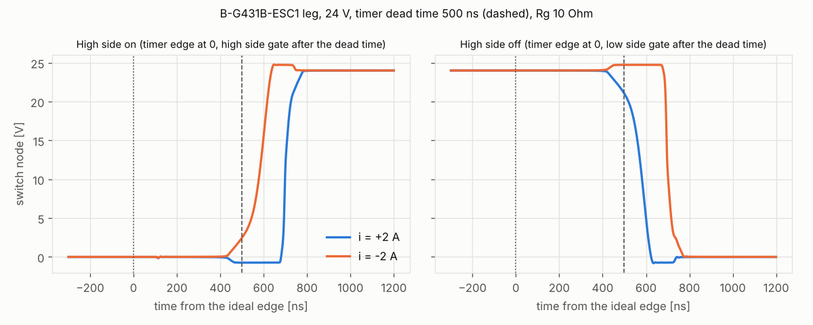

# sfs-stepper-power-spice

ngspice model of one power stage leg of the **STMicroelectronics B-G431B-ESC1**
(L6387E driver, two STL180N6F7 MOSFETs, low-side shunt), used to find the values the
stepper simulation (`sfs-stepper-sim`) and the control library Stepper-C
(`sfs-stepper-ctrl`) need from the real hardware: effective dead time, leg resistance,
body diode drop, dead time margin and the settling of the current shunt.

> **Status:** device model fitted to the datasheet (SP01), dead time and switch node
> (SP02), shunt sampling (SP03); export to `sfs-stepper-sim`. Several board values are
> **assumptions** until checked against the ESC1 schematic (see below).

## Requirements

- **ngspice** 42 or newer (tested with 45.2), command line version:
  - Windows: download the 64-bit zip from <https://ngspice.sourceforge.io/download.html>,
    unpack it and set `NGSPICE` to `...\Spice64\bin\ngspice_con.exe`
    (or `pacman -S mingw-w64-ucrt-x86_64-ngspice` in MSYS2);
  - Linux: `apt install ngspice` or a build from source (XSPICE is not needed).
- Python 3.9+ with `numpy` (`matplotlib` for the plot): `pip install -r requirements-dev.txt`.

## Usage

```bash
python tools/run_tests.py                 # all tests (about 40 s)
python tools/run_tests.py --quick         # fewer operating points
python tools/run_tests.py --export        # + export/stage_esc1.json and, when
                                          #   ../sfs-stepper-sim exists, its params/stage_esc1_spice.*
python tools/plot_leg.py                  # docs/leg_edges.png
```

`NGSPICE=<path>` selects the ngspice executable when it is not in `PATH`. Netlists and
waveforms of the last run are in `build/` (open a `.cir` in ngspice to look at it
interactively).

## Results (24 V, 20 kHz, timer dead time 500 ns, Rg 10 Ω, 25 °C)



| Quantity | Result | Used by |
| --- | --- | --- |
| Rds(on) at 10 V, 16 A | 1.90 mΩ (2.47 mΩ at 100 °C) | — |
| leg resistance (switch, low side + shunt, averaged) | 3.4 mΩ | sim `brd.rds_on` |
| body diode at 2 A | 0.73 V | sim `brd.vd` |
| switch node edges after the ideal (timer) edge, 2 A | rising +700 ns, falling +571 ns | — |
| **effective dead time** (fitted for 1–3 A) | **133 ns** | sim `brd.dead_ns`, Stepper-C `dead_time_ns` |
| gap between the driven gates | 154 ns | margin of the timer dead time |
| gate of the off switch while the other turns on | up to 3.7 V | ⚠ above VGS(th) 3 V |
| shunt settled after the low-side timer edge | 345 ns | sampling window |
| largest leg duty with a valid current sample | 0.956 | Stepper-C (to do) |

What the numbers say:

- The MOSFET turns off slowly (about 400 ns from the gate command to the end of the
  Miller plateau with 10 Ω + the L6387 sink of 650 mA), so most of the 500 ns timer
  dead time is used by the turn-off itself: the **effective** dead time seen in the
  phase voltage is only 133 ns, and the margin before both channels conduct is 154 ns.
  Do not reduce the timer dead time without measuring the gate waveforms.
- The voltage error of the dead time is not a clean step at zero current: below 1 A
  the phase current charges the switch node capacitance too slowly to finish the swing
  within the dead time (error 50 % of the step model at 0.5 A, 25 % at 0.25 A). The
  sim keeps the step model; the measured table is in `export/stage_esc1.json`
  (`leg_error_table`) for a better compensation later.
- The Cgd dv/dt pulls the gate of the off switch up to 3.7 V with the assumed gate
  resistors: a short shoot-through at every edge. On the real board check the gate
  resistors / turn-off diodes (or measure VGS) before raising the bus voltage.
- The low-side shunt carries the current also in the dead time (body diode of the low
  switch) and is settled 345 ns after the low-side timer edge, so a centred sample is
  valid up to a leg duty of about 0.95 (with a 250 ns ADC sampling time).

## Tests

| Test | Check |
| --- | --- |
| SP01 | Rds(on) ±5 %, VSD at 32 A ≤ 1.2 V, Ciss / Coss / Crss ±10 %, Qg ±10 % against the datasheet |
| SP02 | mean leg voltage error for −3…+3 A; step model (`-sign(i) (Vbus + 2 Vd) td_eff / Ts - R i`) within 15 mV for 1–3 A; driven gates never overlap; gate bump reported |
| SP03 | shunt voltage at the sampling instant = −i·Rsh within 1 % (d = 0.5, 0.9, ±2 A); settling time |

## Models

| File | Content |
| --- | --- |
| `models/stl180n6f7_sfs.lib` | STL180N6F7 as an ngspice VDMOS model, **fitted by this project** to the datasheet (not the ST model) |
| `models/l6387_behav.lib` | L6387E behavioural: interlocking, 107 ns delay, 30 Ω source / 18 Ω sink, bootstrap DMOS 125 Ω |
| `circuits/esc1_leg.lib` | one leg: driver, MOSFETs, gate resistors, bootstrap capacitor, shunt, layout inductances |

Board values that are **assumptions** (the user manual UM2516 does not list them; take
them from the schematic MB1419 and change `BOARD` in `tools/run_tests.py`):

| Value | Assumed |
| --- | --- |
| timer dead time | 500 ns (firmware setting) |
| gate driver supply | 12 V |
| gate resistors | 10 Ω, no turn-off diode |
| bootstrap capacitor | 1 µF |
| shunt | 3 mΩ, 1 nH |
| commutation loop | 3 nH, damped (1 Ω across each inductance) |
| MOSFET VGS(th) | 3.0 V |

**Vendor models:** ST publishes its own SPICE models on the product pages. They are
not included here (their licence is ST's); to compare, put them into `models/vendor/`
(ignored by git), include them in `tools/run_tests.py` and use them in
`circuits/esc1_leg.lib` in place of `STL180N6F7_SFS`.

## Related repositories

| Repository | Role |
| --- | --- |
| `sfs-stepper-ctrl` | Stepper-C control library |
| `sfs-stepper-sim` | Scilab/Xcos model, uses the exported parameters |
| `sfs-stepper-power-spice` | this model |

## License

Apache License 2.0, see [LICENSE](LICENSE).
